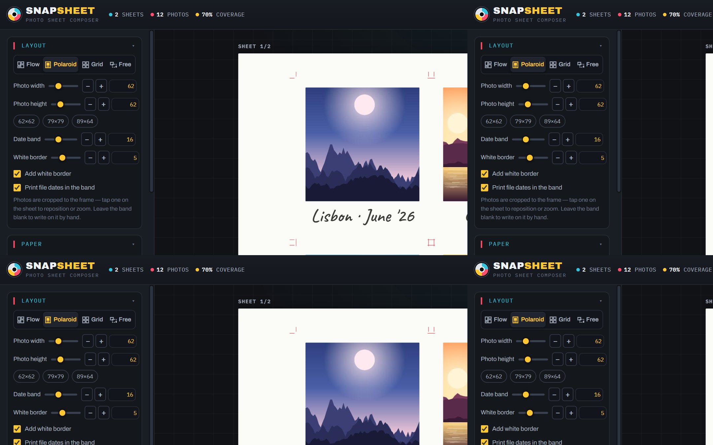
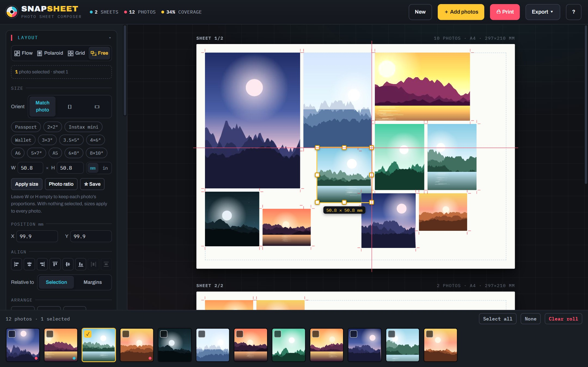
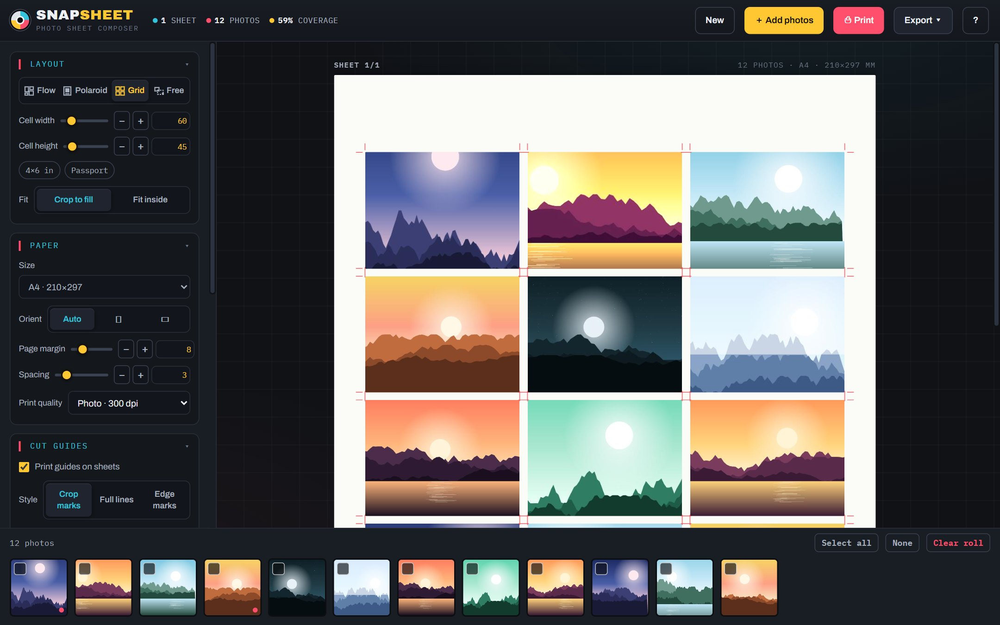

<div align="center">

# SNAPSHEET

**Turn a roll of photos into print-ready sheets, right in your browser.**

Polaroids with handwritten-style dates, tidy grids, tightly packed prints, or a freeform canvas where you place and size every photo yourself, with cut guides, per-photo edits and exports at real physical sizes.

[**▶ Open the app**](https://livesparks.github.io/snapsheet/) · [Features](#features) · [How to use](#how-to-use) · [Run locally](#run-locally)



</div>

> [!CAUTION]
> **This project is entirely LLM-coded.** Every line was written by AI coding assistants, with a human directing the work and testing by hand. There is no automated test suite. Expect rough edges, check your exports before printing on expensive paper, and use it with caution. Bug reports and pull requests are welcome.

## Why

Printing a stack of phone photos at home usually means fighting a word processor or paying for a print shop. SNAPSHEET lays photos out on A4, Letter or any paper size at exact millimetre dimensions. It adds crop marks so you can cut them cleanly and renders sheets at photo-print resolution. **Nothing is uploaded:** every photo is decoded, edited and rendered on your own device.

## Features

| | |
|---|---|
| **Four layout modes** | **Flow** packs photos at their original proportions with as little wasted paper as possible. **Polaroid** adds a white border and a date or caption band. **Grid** uses fixed cells (crop to fill or fit inside). **Free** lets you place and size each photo yourself. |
| **Freeform canvas** | Drag photos (even onto another sheet), resize them with handles, snap to margins, the page centre, other photos and the sheet spacing, and select several at once with Shift-click or a drag-box. Then align, distribute, change the stacking order, auto-arrange, and undo or redo. |
| **Preset & custom sizes** | Passport, 2×2″, Instax mini, wallet, 3.5×5″, 4×6″, 5×7″, A6, A5, 8×10″ and more, or type any size in mm or inches. Sizes can follow each photo's orientation, and you can save your own sizes. |
| **Per-photo editing** | Crop and zoom inside the frame, rotate, adjust brightness, contrast, saturation and sharpening, and add captions. Batch-apply adjustment presets to a selection or the whole roll. |
| **Print-accurate output** | Paper sizes from A3 to 4×6″ (or custom), margins, spacing, and auto orientation that picks whichever uses fewer sheets. Rendering goes from 150 to 600+ dpi, with cut guides as crop marks, full lines or edge marks in a choice of ink colours. |
| **Export & print** | Download sheets as JPG, PNG or a multi-page PDF, or print directly at actual size. |
| **Every format** | JPG, PNG, WebP, GIF and iPhone HEIC/HEIF, by file picker, drag and drop, or paste. |
| **Picks up where you left off** | Photos, edits and layouts are saved in your browser (IndexedDB) and survive a reload. Press **New** to start over. |
| **Private by design** | No server, no account, no tracking. Your photos never leave the device. |

## Screenshots

<table>
<tr>
<td width="50%"><br><sub><b>Freeform:</b> mixed print sizes on one sheet, a photo snapping to its neighbours mid-drag.</sub></td>
<td width="50%"><br><sub><b>Editor:</b> crop in frame, rotate, tune colour and sharpening, add a caption.</sub></td>
</tr>
<tr>
<td width="50%"><br><sub><b>Grid:</b> uniform cells with crop marks for clean cutting.</sub></td>
<td width="50%"><br><sub><b>Start:</b> drop, pick or paste photos. Everything stays on-device.</sub></td>
</tr>
</table>

## How to use

1. **Add photos.** Click **Add photos**, drop files anywhere on the page, or paste with Ctrl/Cmd + V.
2. **Pick a layout** in the side panel and set the paper size, margins and spacing.
3. **Refine.** Click a photo (double-click in Free mode) to crop, rotate, adjust or caption it. Tick photos in the film strip to apply batch adjustments or freeform sizes to a selection.
4. **Print or export.** In the print dialog choose **Actual size / 100%** with margins set to **None**, so the millimetres on screen are the millimetres on paper.

### Freeform shortcuts

| Action | How |
|---|---|
| Move / resize | Drag a photo · drag a handle (corners keep proportions, **Shift** stretches) |
| Multi-select | **Shift**-click, drag a box on empty paper, or **Ctrl/Cmd + A** |
| Nudge | Arrow keys: 1 mm, or 10 mm with **Shift** |
| Temporarily disable snapping | Hold **Alt** while dragging |
| Undo / redo | **Ctrl/Cmd + Z** / **Ctrl/Cmd + Shift + Z** |
| Remove from sheet | **Delete** (bring it back from the film strip) |
| Edit photo | Double-click |

## Run locally

SNAPSHEET is a static site with no framework and no runtime dependencies. Any static file server works:

```sh
git clone https://github.com/LiveSparks/snapsheet.git
cd snapsheet
python -m http.server 8000        # or: npx serve .
```

Then open <http://localhost:8000>.

### Project layout

```
src/
  index.html        page structure and controls
  styles.css        visual design and responsive layout
  js/               ordered modules, concatenated into app.js
    05-import-pipeline.js    decoding (incl. HEIC), thumbnails
    06-layout-engines.js     flow / polaroid / grid packing
    07-rendering-pages.js    on-screen sheets and cut guides
    09-editor-modal.js       per-photo crop and adjustments
    10-export-print.js       high-dpi rendering, PDF/PNG/JPG, print
    11a-freeform.js          freeform canvas: snapping, sizing, alignment
    13-persistence.js        IndexedDB save / restore
scripts/build.mjs   copies src/ to the repo root and bundles app.js
```

After editing anything in `src/`, run `npm run build` (Node 20.11+) to regenerate the root `index.html`, `styles.css` and `app.js` that get deployed.

### Deployment

Every push to `main` runs [`.github/workflows/pages.yml`](.github/workflows/pages.yml), which builds the site and publishes it to GitHub Pages.

## Under the hood

- Layouts are computed in millimetres and rendered on a `<canvas>` at the chosen dpi, so a 62 mm polaroid prints at 62 mm.
- HEIC/HEIF decoding uses [libheif-js](https://github.com/catdad-experiments/libheif-js), with [heic2any](https://github.com/alexcorvi/heic2any) as a fallback. PDFs are built with [jsPDF](https://github.com/parallax/jsPDF). All three, plus Google Fonts, load from jsDelivr and Google at runtime, so HEIC import, PDF export and the typefaces need an internet connection.
- Exports render one sheet at a time and free each canvas immediately, so long runs stay within browser memory limits. Very high dpi settings can still exceed what a browser can draw; the app tells you when that happens.

## Caveats

- **LLM-generated code:** see the caution note above. Review the code before relying on it for anything important.
- Browser storage can be cleared by the browser or by you. Treat saved projects as a convenience, not a backup, and keep your original photos.
- Printer drivers vary. Always print one test sheet at actual size and measure it before a big batch.
